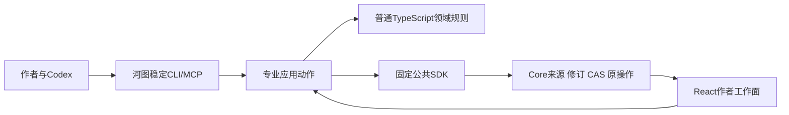
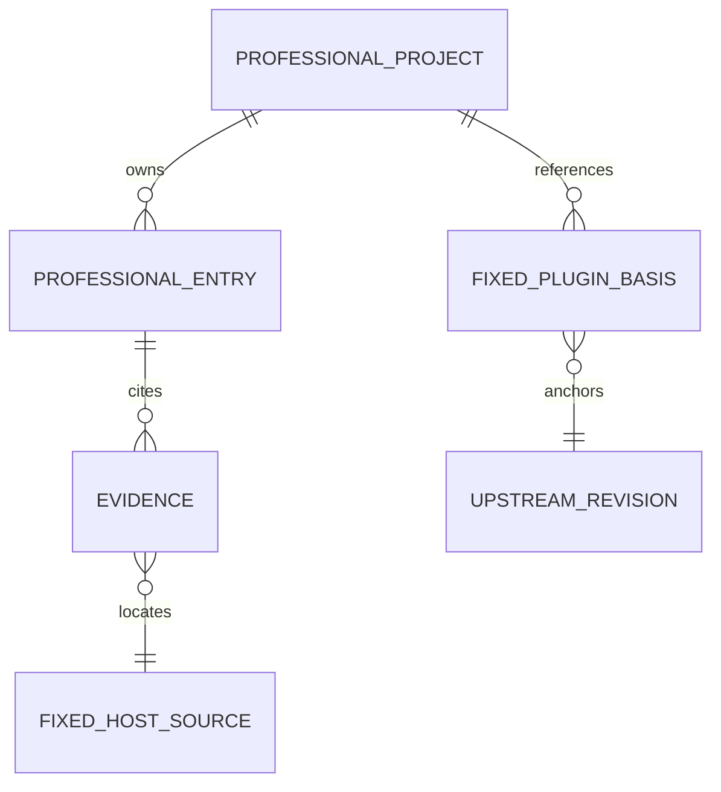
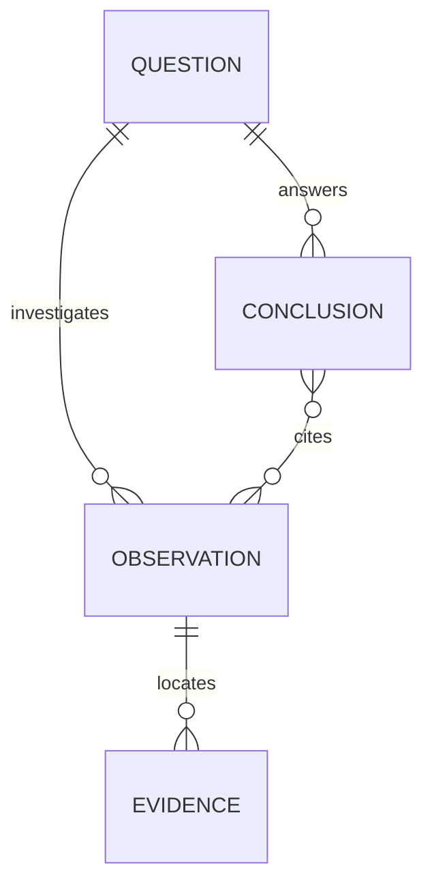
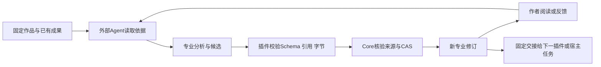

> 本文属于[创作研究台文档](README.md)。

# 架构与领域设计

## 1. 分层

领域层不依赖React、Cordis或私有文件，应用层组合纯计算与SDK，后端只适配受管生命周期。视图读同一状态，不拥有独立业务事实。宿主使用Cordis不要求本包直接依赖Cordis；DSH参考不是可直接安装的兼容包。

## 2. 数据责任与存储

专业聚合为`story_research`，根字段`format_version`、`title`、questions／observations／conclusions／basis_refs。由宿主受管扩展对象存储，不增设数据库。宿主文件是事实源，查询索引可重建；本包不直写`.hetu`、原稿或其他插件目录。

证据通过source_index指向同作品的固定来源，索引只追加。`basis_refs`固定同作品上游插件的Owner、object_id、revision、sha256；通过公开只读入口核验，不把专业引用当正式设定或额外授权。写入仍只能修改本包对象。

## 3. 演进

首版格式1，公共SDK固定摘要随包校验。未知字段拒绝；新格式先写迁移合同和旧样本，产生新专业修订，不覆盖旧历史。停用或卸载不删除历史；包回退不等于数据回退。框架私有结构不持久化。

## 4. 专业关系

专业关系归本插件聚合，证据定位及上游专业依据归宿主固定引用合同。专业内容和追加来源随CAS事务形成新修订，不另增数据库或双写索引。

