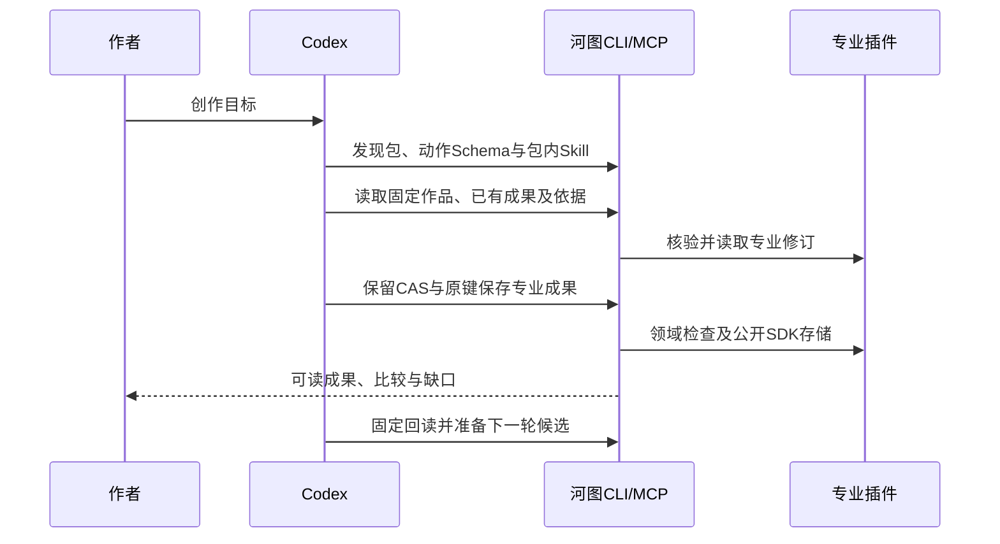

> 本文属于[创作研究台文档](README.md)。

# Skill与机器协作

包内`hetu-story-research`方法由河图动态注册和skills.read读取，不安装同名Codex插件或另启MCP。Skill只规定专业决策和依据要求，动作参数读取当前Schema；完整旅程为：提出问题 → 固定资料 → 区分引文、观察与推断 → 比较支持与反证 → 形成带限制的结论 → 固定交接给规划或写作。

先发现实际安装版本、WorkRef与确切management_ref，再读取既有成果；任务读取仍携带宿主task_ref。专业推断与正式事实分开，实际阅读与覆盖如实报告。升级、停用或卸载后重新发现；旧连接不等于旧能力永久有效。

下游接续使用固定basis_refs；生成和语义理解由外部Agent完成，候选提交宿主独立任务，不能要求用户将对话内容重新填表。正文采纳、定稿、外发和费用仍分别决定。
